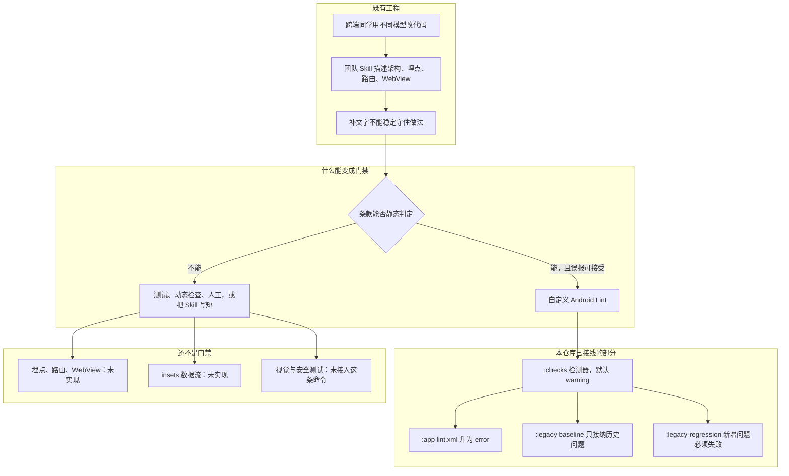
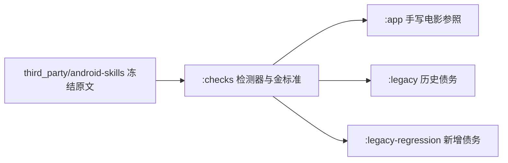

# 架构

这张图描述本仓库的质量门禁，不是官方 Skill 运行时，也不是团队规范的全图。

模块：

提交前已经验证的聚合任务是 `./gradlew qualityGate`。它不覆盖图中「还不是门禁」的部分。

`AGENTS.md` / `CLAUDE.md` 只是把命令写给人看。本地 hook 可以跳过。合入强制要靠受保护分支的 required check，并审查对 `checks/`、`lint.xml`、`lint-baseline.xml` 的修改。本仓库没有打开这项保护。
