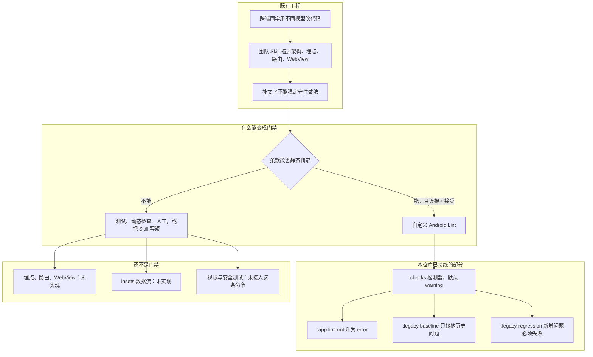
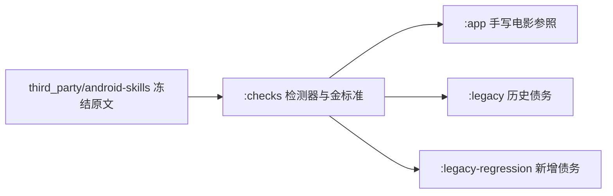

# docs

源码快照 commit：`9441209aadafb1f33c3694643eed5880fa715177`

以下是该目录在该 commit 的完整文本，不是片段。二进制文件只出现在索引里。

## `docs/ci-建议.md`

sha256 `b3292165bb1c79f02dab1de97d154e579bbddcebba8946b58d46d15b721bee82`

```md
# CI 建议

`.github/workflows/quality-gate.yml` 定义了两步：

1. `./gradlew qualityGate`，期望退出码 0
2. `./gradlew :legacy-regression:lintDebug`，期望退出码非 0

工作流文件在仓库里，不表示 GitHub 已经把它设成 protected branch 的 required check。本次没有仓库管理员权限去打开分支保护，因此不能声称合并会被这条检查拦住。

本地或代理文件里的命令也拦不住跳过 hook 的提交。

要挡住「改检测器或刷新 baseline 放行」，还需要这些路径的评审，例如 `checks/**`、`**/lint.xml`、`**/lint-baseline.xml`。同一变更集里如果同时放松断言，CI 退出码仍然会是 0。这是门禁的已知缺口，不是已经解决的问题。

下面只是分支保护的配置草稿，没有被执行：

- 保护 `main`
- 要求 `quality-gate` 这个 job 的 check 通过才能合并
- 要求对检测器和 baseline 路径有指定评审人
- 不允许管理员用刷新 baseline 代替修复，除非评审记录写明偿还了哪些历史问题

Lint 通过不等于功能、视觉或安全通过。
```

## `docs/实验协议.md`

sha256 `df11dcd9d904b8f63e0ecd0e0672e2b5af185c7f0ebab6f221008c5ebed8556a`

````md
# 实验协议

状态：预先登记。模型对照尚未执行。本文登记任务、快照、分母和评分，避免事后把夹具说成样本。

文章想回答的问题是：既有 Android 工程里，最佳实践怎样变成提交前会失败的质量门禁。官方 Skills 只作为这次可检查条款的外部参照。团队自己的架构、埋点、路由和 WebView 桥规范不属于官方，也不在本协议的检测器里。

## 问题，不是产品介绍

场景是一个已经存在的安卓仓库。iOS、前端或其他端的同学用不同模型提交代码。团队曾经用 Skill 描述仓库架构、埋点、路由和 WebView 桥，但继续往 Skill 里补句子，并没有让这些做法稳定地出现在合并结果里。代码写得快，不代表合入质量稳定。

本协议比较的是「文本指导」和「可执行门禁」，不是给 Skill 或 Lint 做功能介绍。

跨模型、长上下文下，指令遵循可能不稳定。这是待验证的工程假设。本轮没有测量它。不能把每一次违规归因于 attention。attention 不是人的记忆；讨论它需要原始论文和单独实验。这里两样都没有，因此协议不设注意力实验，结果文档也不写注意力结论。

## 两条互补的轴

- 交付流程编排：把需求排到实现、测试和交付。它负责事情按顺序做完。
- 项目特定的可执行质量门禁：这条仓库里、提交前会以非 0 退出的检查。它只对已经写成检查的条款负责。

两条轴互补。本协议不点名任何「从 PRD 到交付」的产品，也不判断那些产品有没有质量保障，不借用大厂是否做过来支持或否定任何一方。有一个被提到的名称与公开的酒店客服站点撞名，用途对不上，所以全文不使用该名称。

## 冻结快照

| 项 | 值 |
| --- | --- |
| 上游 | https://github.com/android/skills |
| 标签 | v1.0.21 |
| Commit | `5815d27fda564aa9f07ebdcb5e57ed3e8d904e0d` |
| 本地副本 | `third_party/android-skills/` |
| 许可证 | Apache-2.0，见该目录 `LICENSE.txt` |
| 纳入实验臂的 Skill | adaptive、navigation-3、edge-to-edge |
| 读过但两臂都不加载 | jetpack-compose-performance |
| 不纳入 | 仓库里其余 Skill |

官方文档页 https://developer.android.com/tools/agents/android-skills 说明这些是按任务激活的模块化指导，不是一份通用 Compose 或架构总规范。本次阅读没有发现上游把下列条款打包成构建期强制 Android Lint。

## 统一任务

见 `experiment/prompts/task.md`。两臂使用同一任务、同一三份 Skill、同一 Gradle 工具链。performance skill 两臂都不加载。它原本面向既有界面的性能诊断；若将来纳入，两臂必须同时加载同一份，不能只加在看到 Lint 的那一臂。

## 臂

| 臂 | 可见材料 | 状态 |
| --- | --- | --- |
| A | 任务 + 三份 Skill。不读 `checks/`，不跑自定义 Lint | 未执行 |
| A2 | A 的等轮次或等预算自审，仍然不看 Lint | 未执行。没有它，就不能把 Lint 说成独立因果 |
| B | 与 A 相同的首轮；第二轮只读 `lintDebug` 原始输出并修复 | 未执行 |

隔离要求：单独会话，首轮产物只读，不回写。保存每轮补丁、原始报告、命令退出码、墙钟时间。禁止手写注入违规冒充模型输出。禁止生成者改规则、改 baseline 或加 suppression 过关。禁止为了调用模型去抓取平台凭据。

## 样本与分母

- 目标：每臂独立会话 N≥5；资源允许则 8
- 已执行模型会话：0
- 缺几个就记几个，不把夹具或单次手写 demo 凑进 N
- 功能验收单独记通过或失败。功能没做不能标成规则 N/A
- 代码合规只统计适用且已实现的检测器，并列出覆盖
- 编译失败、Lint 失败、基础设施失败分开。基础设施失败是未测，不是代码通过
- 视觉、架构、运行成功与 Lint 合规分开记。不预设看到 Lint 的一臂更好

## 评分

评分脚本 `scripts/score_run.py` 只统计 lint XML 里这五个 id 的条数，并读取 meta 里的 `sample_kind`。

适用 id：

- `AdaptiveScreenOrientationLock`
- `AdaptiveConfigChangesOptOut`
- `UnsaveableScrollRemember`
- `AdaptivePaneScaffoldBanned`
- `MissingEnableEdgeToEdge`

`sample_kind` 不是 `model_arm_a`、`model_arm_b` 或 `model_arm_a_self_review` 时，输出不得称为模型 A/B。手写参照实现使用 `reference_implementation_not_model`。检测器金标准使用 JUnit，不走这个脚本的模型字段。

功能清单（与 Lint 分开）：本地数据不少于 30 条、无网络、占位海报有标记、列表/详情、加载/空/错误可复现、窄窗单栏与 Expanded 双栏、edge-to-edge、配置变化后滚动和选中仍在、不锁方向。其中需要设备或截图的项，在没有真实运行时记未测。

## 排除

- 把 `:checks:test` 的正负例当成模型样本
- 把 `app/` 手写参照当成盲测
- 把 `legacy/` 的修复演示当成生成能力提升
- padding、IME 数据流、lazy `key` / `contentType`：本轮未做成检测器，不记成通过
- 团队埋点、路由、WebView：不是官方条款，本轮没有检测器，不记成官方合规

## 基线门禁

历史样本 `:legacy` 用生成的 `lint-baseline.xml` 接纳已有违规，`lintDebug` 应为 0。新增违规不得靠刷新 baseline 消失。负例是 `:legacy-regression:lintDebug` 非 0，以及 `scripts/verify-legacy-gate.sh` 临时加文件后的非 0。baseline 不检查架构是否正确。

严重级别：检测器库默认 warning；`app` 与 `legacy` 的 `lint.xml` 升为 error。这是「先警告，再在接入模块收紧」，不是两套规则。

## 提交前命令与它的边界

对已经接入、并且本仓库验证过的检查，命令是：

```bash
./gradlew qualityGate
```

它依赖 `:checks:test`、`:app:testDebugUnitTest`、`:app:lintDebug`、`:legacy:lintDebug`。

负例命令是：

```bash
./gradlew :legacy-regression:lintDebug
```

期望非 0。

`AGENTS.md` 和 `CLAUDE.md` 里写下这条命令，只是给人和代理的提示。本地 hook 可以不装、可以跳过。要让不合规的变更合并不了，需要受保护分支上的 required status check，并且规则实现、`lint.xml` 和 `lint-baseline.xml` 的修改要经过别人审查。同一 PR 里同时改检测器和测试，流水线自己看不出来。本仓库没有权限配置分支保护，也不声称 GitHub required checks 已经打开。`.github/workflows/quality-gate.yml` 只是会随 PR 运行的工作流定义，不等于 required check。

这条命令不保证全部最佳实践。它不代替功能测试、视觉检查和安全测试。不能静态判定的条款仍然交给测试、动态检查、人工，或把 Skill 写短，而不是继续堆句子。

## 展望（本轮不实现）

以后可以从日常合并请求和评审里反复出现的问题提炼候选规则。候选要经过人审、正例、负例和误报验证，再进入门禁。这是展望。本轮不建设每日监控，也不自动从评审里生成规则。

## 执行记录

模型臂：未执行。原因见 `experiment/runs/NOT_RUN.md`。

检测器、参照应用和 baseline 门禁的命令、退出码和耗时，以 `evidence/` 里该次运行写出的文件为准。协议正文不预填这些数字。
````

## `docs/工具链.md`

sha256 `c53fd164f6d105995f0c58c264c193bded6f3073c251cb439d26958cd8537dc4`

```md
# 工具链

版本在写代码前按公开元数据钉死。运行后的实际观察写入 `evidence/toolchain.txt`，以那个文件为准；若两者不一致，以证据文件里的命令输出为准，并在研究笔记里说明。

| 组件 | 钉死版本 | 依据 |
| --- | --- | --- |
| Android Gradle Plugin | 9.5.1 | Google Maven 上该线的稳定版。发行说明写明最低 Gradle 9.6.0 |
| Gradle | 9.6.0 | AGP 9.5 兼容表的最低与默认 |
| JDK 编译目标 | 17 | AGP 9.5 最低 JDK 17。运行 JDK 见证据文件 |
| Kotlin / KGP | 2.2.10 | AGP 9.5.1 模块元数据对 `kotlin-gradle-plugin` 的要求 |
| Compose BOM | 2026.09.00 | Google Maven；当时 material3 1.4.0、runtime 1.12.1 |
| Navigation 3 | 1.2.1 | 该坐标当时的最新稳定版，不用 1.3 alpha |
| adaptive / adaptive-layout / adaptive-navigation3 | 1.3.0 | 稳定版。`rememberListDetailSceneStrategy` 在这份源码里 |
| activity-compose | 1.13.0 | 稳定版，含 `enableEdgeToEdge` |
| kotlinx-serialization | 1.9.0 | 与 Kotlin 2.2 配套的稳定线 |
| lint-api / lint-tests | 32.5.1 | 与 AGP 9.5.1 的 `sdk-common` 32.5.1 对齐 |
| compileSdk / targetSdk | 37 | Compose runtime-saveable 1.12.1 要求编译期 API 至少 37。edge-to-edge 技能要求 target 35 或更高。安装的平台是 `platforms/android-37.0`。AGP 9.5 最高记到 37 |
| build-tools | 36.0.0 | AGP 9.5 默认 |
| minSdk | 24 | 应用自己的选择 |

业务数据在 `app/src/main/java/com/example/movielab/data/Catalog.kt`，不访问网络。

SDK 路径只放在不提交的 `local.properties`。仓库不包含 SDK、密钥或本机绝对家目录。
```

## `docs/架构.md`

sha256 `21f8f3b9f866954fb66a88a98b4b8830aec5f8a6d389231f2007e4de2f65a960`

````md
# 架构

这张图描述本仓库的质量门禁，不是官方 Skill 运行时，也不是团队规范的全图。



模块：



提交前已经验证的聚合任务是 `./gradlew qualityGate`。它不覆盖图中「还不是门禁」的部分。

`AGENTS.md` / `CLAUDE.md` 只是把命令写给人看。本地 hook 可以跳过。合入强制要靠受保护分支的 required check，并审查对 `checks/`、`lint.xml`、`lint-baseline.xml` 的修改。本仓库没有打开这项保护。
````

## `docs/研究笔记.md`

sha256 `f3b2de295f04ee34bf1f780a985bcee131bd1335d47c2c17aa971981e0572455`

````md
# AI时代的Android架构演进：在既有工程中把最佳实践变成质量门禁

这是研究笔记，不是终稿。终稿要等模型对照有真实会话之后再写。这里先固定问题、推导和已经能跑的门禁。数字只引用 `evidence/` 里的命令输出；本节初稿不预写百分比。

## 问题

既有 Android 仓库里，iOS、前端或其他端的同学会用不同模型改代码。团队曾经用 Skill 描述本仓库的架构、埋点、路由和 WebView 桥。这些文字有用，因为它们把做法说清楚了。继续往 Skill 里补句子，并不能让下一次提交稳定遵守。

代码产出变快之后，合入质量仍要单独约束。快不证明对。

官方 Android Skills（android/skills v1.0.21，commit `5815d27fda564aa9f07ebdcb5e57ed3e8d904e0d`）是一组按任务激活的模块化指导，不是通用 Compose 或架构总规范，也不是团队规范。本次冻结阅读没有发现上游把下面这些条款做成构建期强制 Android Lint。实验室检测器是我们写的，不能说成官方规则，也不能把埋点、路由或 WebView 桥算到官方头上。

## 推导

1. 起点是既有工程里「写过，但守不住」。
2. 团队 Skill 适合承载上下文。它不是执行器。
3. 跨模型、长上下文时，指令遵循可能不稳定。这是还没测的假设。不能把违规解释成 attention。attention 不是人的记性；要讨论它，需要原始论文和专门实验。本轮两样都没有。
4. 能静态判定、而且误报边界写得清的条款，优先做成 Lint。提交前一条 Gradle 命令比要求模型记住全部 Skill 更可重复。
5. 不能静态判定的，交给测试、动态检查、人工，或者把 Skill 写短。不要假装所有最佳实践都能 Lint。
6. 电影列表是参照实现和检测器的集成样本。它不是模型 A/B。
7. 老仓库用 baseline 只拦住新增，再把规则从 warning 收到 error。baseline 不证明架构正确。
8. 以后可以从反复出现的评审意见里提候选规则，经过人审、正反例和误报验证再进门禁。这是展望。本轮没有做每日监控。

交付流程编排和项目里的可执行门禁是两条轴。前者把需求排到实现和测试，后者让特定条款在这条仓库里失败。二者互补。本文不点名流程产品，也不声称它们没有质量保障。

## 这次实际接上的门禁

五个 id，来源和收窄见 `docs/规则出处.md`。库默认 warning。`app` 与 `legacy` 升为 error。

```bash
./gradlew qualityGate
```

负例：

```bash
./gradlew :legacy-regression:lintDebug
```

`AGENTS.md` / `CLAUDE.md` 写下命令，只是提示。本地 hook 可以跳过。合入要靠受保护分支的 required check，并审查检测器、`lint.xml` 和 baseline 的改动。仓库里的 GitHub Actions 工作流不等于 required check，本次也没有权限去打开分支保护。

这条命令不代替功能、视觉和安全测试。

## 已测与未测

模型会话：0。见 `experiment/runs/NOT_RUN.md`。下面的数字来自本工作区 2026-11-14 的 Gradle 输出，不是模型样本。

| 项 | 结果 | 证据 |
| --- | --- | --- |
| `:checks:test` | 40 个金标准用例，0 失败。四组分别是 7、9、12、12 | `evidence/detector-cases.csv`，JUnit XML |
| `:app:testDebugUnitTest` | `CatalogTest` 4 个用例，0 失败 | `evidence/TEST-com.example.movielab.data.CatalogTest.xml` |
| `:app:lintDebug` | 退出码 0。五个映射 id 都是 0。另有 5 条与本规则无关的 warning（`NewerVersionAvailable` 4，`AndroidGradlePluginVersion` 1），没有把构建打失败 | `evidence/score-app-lint.json` |
| `:app:assembleDebug` | 与单测、lint 同一轮成功，日志写 `BUILD SUCCESSFUL in 24s` | `evidence/durations.txt` |
| `./gradlew qualityGate` | 退出码 0。该次是任务已缓存后的聚合，日志写 `BUILD SUCCESSFUL in 793ms` | `evidence/quality-gate.log`，`evidence/toolchain.txt` |
| `:legacy:lintDebug` 有 baseline | 退出码 0。日志写 5 个 error 和 2 个 warning 被 baseline 滤掉 | `evidence/legacy-gate.json`，约 1 秒 |
| 移走 baseline 再跑 legacy | 退出码 1 | 同上，约 1 秒 |
| legacy 里临时加一条 `remember { ScrollState(0) }` | 退出码 1。脚本退出时删掉临时文件 | 同上，约 2 秒 |
| 恢复后的 legacy | 退出码 0 | 同上，约 1 秒 |
| `:legacy-regression:lintDebug` | 退出码 1。映射计数里只有 `UnsaveableScrollRemember` = 1 | `evidence/score-regression-lint.json`，约 2 秒 |
| 模拟器安装与无障碍树 | APK 安装成功，Activity 已启动。`uiautomator dump` 能看到「本地片单」、搜索框、四个演示状态，以及「雾港夜车」等标题和「占位海报 / PLACEHOLDER」 | `evidence/screenshots/phone-content-hierarchy.xml` |
| 画面截图、旋转后滚动与选中 | 未验收。`-no-window`、guest GPU、Xvfb 三种方式抓到的帧都接近全黑（`screencap` 均值 0，15580 字节；Xvfb 中心裁剪均值约 0.09）。不能称为视觉合格 | `evidence/screenshots/capture-log.txt` |
| 模型 A/B | 未测。N = 0 | 不能用参照应用或金标准代替 |

`evidence/score-parser-smoke.json` 只解析了 `experiment/fixtures/parser-smoke-lint.xml`。那个 XML 是手写的一行夹具，用来看脚本会不会读文件，不是一次 Lint 运行，更不是模型结果。

检测器柱状图 `evidence/detector-cases.svg` 的高度就是上表的 JUnit 用例数。标题写明它不是模型通过率。

## 已知局限

- `configChanges` 只报五种与尺寸、方向、密度相关的 token。
- `remember` 必须解析到 `androidx.compose.runtime`；构造器必须解析到四个 foundation 类型。工厂包装是漏报。
- `enableEdgeToEdge` 看不到其他模块里基类的方法体时，可能误报子类。
- 测试源码不查。
- padding 与 performance skill 的 lazy key 没有检测器。
- 同一 PR 可以同时改规则和测试，退出码仍可能是 0。
````

## `docs/规则出处.md`

sha256 `0c99526b5411811d806617b9b6b119090197e0bf47b0a3c2927f54ed0430c77f`

```md
# 规则出处

检测器是这个仓库写的 Android Lint `Detector` / `IssueRegistry`，用 UAST 或 manifest DOM，不是对源码做字符串搜索。严重级别在注册表里是 warning。它们不是 Android Gradle Plugin 自带规则，也不是团队规范。

冻结文本：`third_party/android-skills/`，v1.0.21，`5815d27fda564aa9f07ebdcb5e57ed3e8d904e0d`。

## 实现了的映射

| id | 冻结原文里的可判定要求 | 实现时收窄的地方 | 金标准 |
| --- | --- | --- | --- |
| `AdaptiveScreenOrientationLock` | adaptive Step 6：不要往 manifest 加 `android:screenOrientation` | 任何非空值都报，包括 `fullSensor`。相机等故意锁方向的要显式抑制 | `ManifestAdaptationDetectorTest` |
| `AdaptiveConfigChangesOptOut` | 同一句：不要用 `configChanges` 逃避重建 | 只报 `orientation`、`screenSize`、`screenLayout`、`smallestScreenSize`、`density`。`uiMode`、键盘、locale 不报。这比原文的绝对说法窄 | 同上 |
| `UnsaveableScrollRemember` | adaptive Step 6.2：`remember { LazyListState() / LazyGridState() / ScrollState() }` 绕过 Saver；并列出 `LazyStaggeredGridState` 的替换函数 | 解析到 `androidx.compose.runtime` 的 `remember` / `rememberSaveable`，且构造器解析到 foundation 的这四个类型。显式 `saver =` 不报，但不检查 saver 对不对。包一层工厂函数不报 | `UnsaveableScrollRememberDetectorTest` |
| `AdaptivePaneScaffoldBanned` | adaptive Step 3：多栏必须用 Navigation 3 SceneStrategy，不要用 `ListDetailPaneScaffold` 或 `SupportingPaneScaffold` | 只报 `androidx.compose.material3.adaptive.layout` 里这两个函数调用。SceneStrategy 与 Defaults 不报。edge-to-edge 技能只是把旧 scaffold 当作 insets 例子，禁用来自 adaptive | `AdaptivePaneScaffoldDetectorTest` |
| `MissingEnableEdgeToEdge` | edge-to-edge Step 2 与 checklist：每个 Activity 在 `setContent` 之前调用 `enableEdgeToEdge` | `androidx.activity` 扩展和 `WindowCompat.enableEdgeToEdge` 都算。同名本地函数、`setDecorFitsSystemWindows` 不算。同一类里一层辅助函数算。源码超类仅在调用了 `super.onCreate()` 或未重写 `onCreate` 时算。抽象类、测试源、`android.app` / `androidx.activity` / `appcompat` / `fragment` / `core` 包名跳过。WindowCompat 那条图标对比规则没做 | `MissingEnableEdgeToEdgeDetectorTest` |

抑制：Kotlin `@Suppress("问题 id")`，manifest `tools:ignore`。金标准里各有一条抑制后应为干净的用例。抑制不是过关手段；门禁文档要求生成臂不许用它。

## 读过但没做成检测器

| 条款 | 原因 |
| --- | --- |
| insets / padding / IME 是否重复 | 依赖父级 `contentWindowInsets` 和修饰符顺序，误报高。参照应用按原文里标成 RIGHT 的写法做了，但没有用检测器证明 |
| lazy `key` 与 `contentType` | 来自 performance skill。该技能是既有界面的诊断流程，两臂都不加载。不把「没检测」写成通过 |
| `NavigationSuiteScaffold`、桌面快捷键、折叠 tabletop | 不是少量可判定 API 禁令 |
| `WindowCompat.enableEdgeToEdge` 之后的图标明暗 | 有条件，且 ComponentActivity 那条路径原文说会自己处理。参照应用走的是 ComponentActivity |
| 任意 `remember { mutableStateOf }` 都改成 `rememberSaveable` | 范围过大，很多状态不需要跨配置保留 |
| 团队埋点、路由约定、WebView 桥 | 团队规范。不是官方 Skill 条款。本轮没有检测器，也不能写成官方规则 |

## 参照应用怎么对应原文

`app/` 是手写参照，用来让检测器在真实模块上跑，并留下一个可编译的电影列表。它不是盲测样本。

- 列表/详情：`rememberNavBackStack` + `rememberListDetailSceneStrategy`，metadata 用 `listPane` / `detailPane`。见 vendored `material-listdetail.md` 与 `basicsaveable.md`
- 窄窗与宽窗：使用 `calculatePaneScaffoldDirective(currentWindowAdaptiveInfoV2())`。原文依赖的 Material directive 在 Compact 和 Medium 都是 1 个横向分区，Expanded 及以上才是 2。双栏不是「所有叫平板的设备」
- 返回：单栏显示返回，双栏不显示。对应 adaptive Step 3.1「list-detail 时详情不要返回箭头」
- 滚动：`rememberLazyGridState()`、`rememberScrollState()`
- 选中：详情键留在可保存的 back stack 上
- edge-to-edge：`enableEdgeToEdge()` 写在 `super.onCreate()` 和 `setContent` 之前；manifest 有 `adjustResize`，没有方向锁和 `configChanges`
- 列表：`LazyVerticalGrid` + `GridCells.Adaptive`
- 海报：`PlaceholderPoster` 绘制渐变并写明「占位海报 / PLACEHOLDER」

加载、空、错误是本地枚举，不发网络。这是可复现状态，不是接口模拟器。
```
